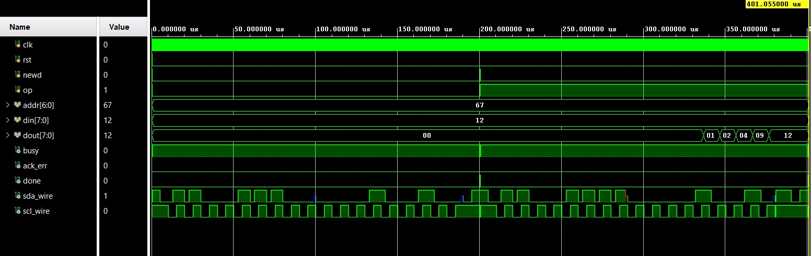

# Design and FPGA Implementation of an I²C Master Controller using Verilog HDL

## 📌 Overview
This repository contains the complete Register Transfer Level (RTL) design, functional simulation, and FPGA hardware implementation of an **I²C (Inter-Integrated Circuit) Master Controller**. 

Designed using **Verilog HDL**, the controller manages synchronous, two-wire serial communication over the Serial Data Line (SDA) and Serial Clock Line (SCL). The architecture utilizes a robust Finite State Machine (FSM) for protocol sequencing, a parameterizable clock divider to generate the 100 kHz bus clock from a 100 MHz system clock, and accurately models the open-drain bus topology.

The design is verified through behavioral simulation using a custom slave model and successfully deployed on the **Digilent Arty S7-25 (Spartan-7) FPGA board**, where it communicates with a physical **MPU-6050 sensor** over the I²C bus.

## ✨ Key Features
*   **Protocol Support:** Full generation of START/STOP conditions, 7-bit slave addressing, read/write operations, and ACK/NACK detection.
*   **FSM Architecture:** State machine controlling IDLE, START, ADDRESS, DATA, ACK, and STOP phases.
*   **Parameterizable Clock:** Derives standard 100 kHz I²C bus frequency from any system clock (default 100 MHz).
*   **Open-Drain Modeling:** Utilizes Verilog tri-state logic (`1'bz`) to accurately simulate the wired-AND bus behavior.
*   **Hardware Verified:** Successfully synthesized, implemented, and programmed onto the Arty S7-25 FPGA. Timing closure achieved at 100 MHz.


🛠️ Tools & Hardware

HDL: Verilog HDL

EDA Tool: Xilinx Vivado 2025.1

Target Board: Digilent Arty S7-25 (Spartan-7 XC7S25-CSGA324-1)

External Peripheral: MPU-6050 (Accelerometer/Gyroscope)

Pin Mapping: SDA (J13), SCL (J14), Clock (E3), Reset (C18)

📊 Results & Outputs

1. Simulation Result
The RTL simulation verifies the write and read transactions. The waveform below shows the master writing 0xA5 to the slave and successfully reading it back, confirming protocol timing and data integrity.



2. Hardware Implementation
The design achieved timing closure at 100 MHz with minimal resource utilization (<1% LUTs). The bitstream was programmed onto the Arty S7-25, and I²C communication was physically verified using an MPU-6050 sensor connected to the shield header.


🚀 Future Scope

Multi-byte read/write transfers (Burst mode).

Sub-address (Register) transmission for specific sensors.

Repeated START condition support.

Multi-master arbitration.

Integration as an AXI4-Lite peripheral for System-on-Chip (SoC) designs.

👨‍💻 Authors

B. Siri (Roll No: 2411EC010067)

K. Subhash (Roll No: 2411EC010077)

Project Guide: Ms. S. Mrudhula (Assistant Professor)
Department of Electronics and Communication Engineering
School of Engineering, Malla Reddy University, Hyderabad, Telangana, India

## 📂 Repository Structure
```text
├── RTL/                     # Synthesizable Verilog source code
│   ├── i2c_master.v         # Core I2C Master FSM and logic
│   └── top_arty_s7.v        # Top-level wrapper for FPGA pin mapping
├── Constraints/             # Vivado XDC pin assignments
│   └── arty_s7.xdc          
├── Simulation/              # Testbench and verification files
│   ├── i2c_master_tb.v      # Master testbench
│   └── i2c_Slave1.v         # Behavioral slave model for simulation
└── Docs/                    # Project documentation and outputs
    ├── waveform.png         # Simulation result
    └── hardware_output.jpg  # FPGA hardware deployment


    
